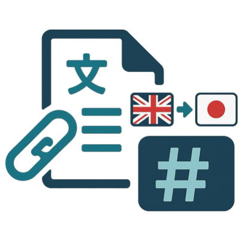

<div align="center">

# Paper2MD-Translator

**Generate a Japanese-translated Markdown file from a paper PDF/URL via Slack**

English | [日本語](./docs/README_ja.md)

</div>

<div align="center">

</div>

<div align="left">
By using this app, you can generate a Japanese Markdown file from a paper PDF or from the URL of a paper PDF, while simultaneously producing a summary.

## Instructions for Users

First, from Slack’s user interface, complete the initial setup by following the instructions in [description.pdf](./description.pdf).<br>
Next, invite the Paper2MD-Translator Bot to the channel where you want to use it, and submit a query by sending a message that mentions `@Paper2MD-Translator` together with the paper URL/PDF, as shown below.

```
@Paper2MD-Translator
https://arxiv.org/abs/2304.08485
```

Currently supported paper formats are as follows.

- Attach the paper PDF directly
- URLs in the form of `http://hoge.pdf` or `https://hoge.pdf`
- arXiv links
  - e.g., `https://arxiv.org/abs/2304.08485`
  - e.g., `https://arxiv.org/pdf/2304.08485`


## Instructions for Operators/Administrators

### Environment Setup

```bash
$ git clone https://github.com/Onely7/Paper2MD-Translator_for_slack.git
$ cd Paper2MD-Translator_for_slack
```

#### Setting Environment Variables

Create a `.env` file under the project directory and fill in the following fields.

```.env
export SLACK_SIGNING_SECRET="<70*****>"
export SLACK_BOT_TOKEN="<xo*****>"
export PORT="<8888>"
export NGROK_AUTHTOKEN="<2z*****>"
export SAVE_PATH="<./results>"
```

* From **[Slack Your Apps](https://api.slack.com/apps)**, create a new app via "Create New App." On the “Paper2MD-Translator” app page, the `SLACK_SIGNING_SECRET` is available under **Settings → Basic Information**, and the `SLACK_BOT_TOKEN` is available under **Settings → Install App**.
* `PORT`: Specify an available port on the server where Paper2MD-Translator will run.
* Create an account on the **[ngrok homepage](https://ngrok.com/)** to obtain the `NGROK_AUTHTOKEN`. By leveraging ngrok, you can associate a local port with a public URL, allowing external access to this app running locally.
* `SAVE_PATH`: Specify the path where intermediate data processed by Paper2MD-Translator and the final artifacts (English papers translated into Japanese Markdown files) will be saved.

#### Create a Python Virtual Environment

Move to the project root directory and run the following.

```bash
$ cd Paper2MD-Translator_for_slack
$ uv python install 3.10.18
$ uv python pin 3.10.18
$ uv sync
```

#### Download Pre-trained Document-Parsing Model

Paper2MD-Translator uses the open-source tool [Dolphin](https://github.com/bytedance/Dolphin) to separate figures/tables and text sections within paper pages (images).
Download in advance the [pre-trained model](https://huggingface.co/ByteDance/Dolphin-1.5) provided by the ByteDance/Dolphin team that is used by this tool.

```bash
$ uv run huggingface-cli download ByteDance/Dolphin-1.5 --local-dir ./Dolphin/hf_model
```


### Start the Paper2MD-Translator Server

#### Preparation 1: Make it able to accept queries from Slack

In Terminal 1, start the Paper2MD-Translator server.<br>
In Terminal 2, start the ngrok server so that you can associate the server’s local port with a public URL and allow external access to this app running locally.<br>
As shown below, open two terminals and keep them running simultaneously. (If you can use tmux, we recommend using tmux to keep both servers running at all times.)

##### Terminal 1

```bash
# Put it in a state of waiting for queries from Slack
$ /bin/bash app.sh
```

##### Terminal 2

```bash
# Associate the local port with a public URL via ngrok
$ /bin/bash run_ngrok.sh

## Example output
Ingress established at NgrokTunnel: "https://ca**********.ngrok-free.app" -> "http://localhost:8888"
```

As a result, the internal local URL `"http://localhost:8888"` is associated with the externally accessible `"https://ca**********.ngrok-free.app"`.<br>
Copy this externally accessible URL (`"https://ca**********.ngrok-free.app"`) because you will use it in later settings.

#### Preparation 2: Configure the Slack App

Next, you need to configure the app properly on the Slack side.<br>
From the “Paper2MD-Translator” app page under **[Slack Your Apps](https://api.slack.com/apps)**, configure the various settings.<br>
Details of the settings are provided in **[this PDF file](./paper2md_translator_app_settings.pdf)**, so please refer to it together.<br>
For **Features → Interactivity & Shortcuts → Interactivity → Request URL** and **Features → Event Subscriptions → Enable Events → Request URL**, use the externally accessible ngrok URL you copied earlier (`"https://ca**********.ngrok-free.app"`) and enter `"https://ca**********.ngrok-free.app/slack/events"` (don’t forget to append `/slack/events`).

This completes the preparation for operators/administrators.<br>
Users should now be able to use it.

## Citation

```bibtex
@software{
  author = {Daiki Shiono},
  month = {Aug},
  title = {{Paper2MD-Translator}},
  url = {https://github.com/Onely7/Paper2MD-Translator_for_slack},
  version = {0.1.0},
  year = {2025}
}
```
