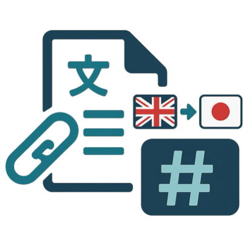

<div align="center">

# Paper2MD-Translator

**論文の PDF や URL を Slack に送ると、日本語に翻訳した Markdown と要約を返す Slack ボット**

[English](../README.md) | 日本語



</div>

## できること

- 論文を送ると、日本語の要約、翻訳した Markdown、Markdown と図表をまとめた ZIP、図表の画像をスレッドに返します。
- ページ内の図表・見出し・本文・数式・参考文献の位置は [Dolphin-v2](https://github.com/bytedance/Dolphin) で解析し、本文は OpenAI のモデルでページの画像から翻訳します。既定のモデルは、翻訳が `gpt-6.1-terra`、要約が `gpt-6.1-sol` です。
- 一度翻訳した論文は保存しておき、次からはすぐに返します。
- `--no-cache` を付けると、サーバーにデータを残さずに処理します。

## 使い方

### 論文を送る

Bot をチャンネルに招待し、メンション付きで論文を送ってください。

```
@Paper2MD-Translator
https://arxiv.org/abs/2304.08485
```

次の形式に対応しています。

- PDF の添付
- PDF の URL（`https://example.com/paper.pdf` など）
- arXiv のリンク（`/abs/`、`/pdf/`、`/html/`）
- Hugging Face Papers と alphaXiv のリンク（arXiv の論文として扱います）
- OpenReview のリンク（`https://openreview.net/forum?id=...`）
- ACL Anthology のリンク（`https://aclanthology.org/2024.acl-long.1/` など）

長い URL がうまく読み取られないときは、URL をバッククォート（`` ` ``）で囲んで送ってください。

使う前に、Paper2MD-Translator の Home タブで OpenAI の API Key を登録してください。Gyazo のアクセストークンも登録すると、投稿される Markdown の図表が Gyazo の画像 URL になります。登録しない場合も、ZIP の中の Markdown では図表が表示されます。

### 翻訳済みの論文

一度翻訳した論文は要約と翻訳を保存しておき、次からはすぐに返します。保存した結果は利用者全員で共有します。

- arXiv の論文はバージョンごとに保存します。同じバージョンなら `/abs/`、`/pdf/`、`/html/` のどのリンクでも同じ論文として扱います。
- バージョンを指定しないリンク（`https://arxiv.org/abs/2408.03326` など）は、送った時点の最新版を翻訳します。以前に v2 を翻訳していても、その後 v3 が公開されていれば v3 を翻訳します。v2 の結果は `https://arxiv.org/abs/2408.03326v2` で引き続き返します。
- ほかの PDF はファイルの中身（SHA-256）で同じ論文かを判定します。名前が違っても中身が同じなら保存済みの結果を返し、同じ名前や同じ URL でも中身が違えば翻訳し直します。
- 翻訳し直すときは `--refresh` を付けてください（`--force`、`再翻訳` でも同じです）。新しい結果で保存済みの結果を置き換えます。
- 一部の翻訳に失敗した結果は保存しません。

### サーバーにデータを残さない

`--no-cache` を付けて送ってください（`no-cache`、`nocache`、`キャッシュなし`、`保存しない` でも同じです）。

```
@Paper2MD-Translator --no-cache
https://arxiv.org/abs/2304.08485
```

送った PDF、途中のファイル、結果は、サーバー上のプロセス専用の一時ディレクトリ（既定は RAM 上の `/dev/shm`、権限 `0700`）だけで扱います。結果をスレッドに投稿したあと、失敗したときも含めてこのディレクトリを削除し、削除したことをスレッドに投稿します。すでに保存されている論文は、このモードでも保存済みの結果を返します。新しく保存するものはありません。翻訳し直すときは `--refresh` も付けてください。保存済みの結果はそのまま残ります。

Slack に投稿したファイル、Gyazo にアップロードした図表、OpenAI 側でのデータの扱いは対象外です。OpenAI へのリクエストは常に `store=false` で送ります。

## セットアップ

### 必要なもの

- Python 3.10 と [uv](https://docs.astral.sh/uv/)
- GPU（Dolphin-v2 は GPU メモリを約 8 GB 使います。CPU でも動きますが、遅くなります）
- Slack ワークスペースにアプリを追加する権限
- 利用者それぞれの OpenAI API Key（各自が Home タブで登録します）

### インストール

```bash
git clone https://github.com/Onely7/Paper2MD-Translator_for_slack.git
cd Paper2MD-Translator_for_slack
uv sync
```

### Dolphin-v2 のモデル

```bash
uv run hf download ByteDance/Dolphin-v2 --local-dir models/Dolphin-v2
```

モデルの大きさは約 7.5 GB です。別のディスクに置く場合は、`DOLPHIN_MODEL_PATH` でその場所を指定するか、`models/Dolphin-v2` にシンボリックリンクを張ってください。Ampere 以降の GPU では bf16、RTX 20 系のような古い GPU では fp16 で動かします。

Dolphin-v2 のライセンスは Dolphin 1.x の MIT ライセンスではなく **Qwen Research License（非商用利用のみ）** です。詳しくは [Dolphin/LICENSE](../Dolphin/LICENSE) を確認してください。

### Slack アプリの作成

1. [Slack の Your Apps](https://api.slack.com/apps) で「Create New App」から「From a manifest」を選び、[slack_manifest.yaml](../slack_manifest.yaml) の中身を貼り付けます。
2. アプリをワークスペースにインストールし、「OAuth & Permissions」にある Bot User OAuth Token（`xoxb-...`）を控えます。
3. 「Basic Information」の App-Level Tokens で、`connections:write` のスコープを付けたトークン（`xapp-...`）を作ります。

このマニフェストは Socket Mode を使います。Socket Mode ではボットのほうから Slack に接続するので、公開 URL も ngrok も要りません。

### 環境変数

リポジトリの直下に `.env` を作り、次の 2 つを書きます。

```bash
export SLACK_BOT_TOKEN="xoxb-..."
export SLACK_APP_TOKEN="xapp-..."
```

`.env` にはトークンが入るので、`chmod 600 .env` で自分だけが読めるようにしてください。

ほかに次の値を設定できます。括弧内は既定値です。

| 変数 | 内容 |
| --- | --- |
| `TRANSLATION_MODEL` | 翻訳に使う OpenAI のモデル（`gpt-6.1-terra`） |
| `SUMMARY_MODEL` | 要約に使う OpenAI のモデル（`gpt-6.1-sol`） |
| `TRANSLATION_REASONING_EFFORT` / `SUMMARY_REASONING_EFFORT` | reasoning effort（`none` / `medium`）。モデルが受け付けない値は、受け付ける値に自動で置き換えます（例: `gpt-6.1-sol` では `none` を `low` にします） |
| `TRANSLATION_IMAGE_DETAIL` | モデルに送るページ画像の detail（`auto`） |
| `OPENAI_MAX_CONCURRENCY` | 1 本の論文で同時に送る OpenAI へのリクエストの数（`8`） |
| `PAGE_RESOLUTION` | PDF のページを画像にするときの長辺のピクセル数（`4000`） |
| `MAX_PDF_PAGES` / `MAX_PDF_MB` | 受け付ける PDF のページ数と大きさの上限（`80` / `100`） |
| `MAX_CONCURRENT_JOBS` | 同時に翻訳する論文の数（`2`） |
| `PAPER_CACHE_DIR` | 翻訳済みの論文の保存先（`data/cache`） |
| `NO_CACHE_WORKDIR` | `--no-cache` の一時ディレクトリを作る場所（`/dev/shm`） |
| `KEY_DB_PATH` | 利用者の API Key を保存する SQLite のファイル（`user_keys.db`） |
| `DOLPHIN_MODEL_PATH` | Dolphin-v2 のモデルの場所（`models/Dolphin-v2`） |
| `DOLPHIN_DEVICE` / `DOLPHIN_DTYPE` | Dolphin-v2 を動かすデバイスと精度（`cuda`。精度は GPU に合わせて bf16 か fp16） |
| `DOLPHIN_MAX_BATCH_SIZE` | Dolphin-v2 が並べて読み取る要素の数（`4`） |
| `DOLPHIN_KEEP_LOADED` | `1` にすると、Dolphin-v2 をリクエストの合間も GPU に置いたままにします（`0`） |
| `DOLPHIN_RECOGNIZE_LABELS` | `all` にすると、上流と同じくすべての要素の文字を Dolphin-v2 で読み取ります（既定では、翻訳で使うタイトル・見出し・参考文献だけを読み取ります） |
| `LOG_LEVEL` | ログの出力レベル（`INFO`） |

`PAPER_CACHE_DIR` には論文ごとのディレクトリ（`arxiv-<id>v<version>/` か `sha256-<hash>/`）を作り、PDF、要約、Markdown、図表、途中のファイル、`manifest.json` を保存します。ディレクトリは権限 `0700` で作ります。

### 起動

```bash
scripts/run_app.sh
```

`.env` を読み込んでボットを起動します。`.env` をほかの利用者も読める権限のときは警告を表示します。tmux などの中で起動しておくと、ログアウトしたあとも動き続けます。

### HTTP モードで動かす

Socket Mode を使わない場合は、`SLACK_APP_TOKEN` を書かずに、`SLACK_SIGNING_SECRET`（Basic Information の Signing Secret）、`PORT`、`NGROK_AUTHTOKEN` を `.env` に書きます。マニフェストは `socket_mode_enabled: false` にし、Event Subscriptions と Interactivity の Request URL を `https://<ngrok のドメイン>/slack/events` にします。

```bash
scripts/run_app.sh    # ターミナル 1
scripts/run_ngrok.sh  # ターミナル 2。Request URL を表示します
```

ngrok の無料プランでは起動のたびに URL が変わるので、そのたびに Slack 側の Request URL も変える必要があります。

### コマンドラインでの翻訳

Slack を通さずに翻訳することもできます。`OPENAI_API_KEY` を設定して実行してください。

```bash
OPENAI_API_KEY=sk-... uv run python -m paper2md translate https://arxiv.org/abs/2304.08485 --out results/llava
```

`--gyazo`（`GYAZO_ACCESS_TOKEN` を使います）、`--translation-model`、`--summary-model` も指定できます。

### キャッシュの管理

```bash
uv run python -m paper2md cache list                      # 保存済みの論文の一覧
uv run python -m paper2md cache show arxiv:2408.03326v3   # 1 件の詳細
uv run python -m paper2md cache remove arxiv:2408.03326v3 # 1 件の削除
uv run python -m paper2md cache prune --older-than 180    # 180 日より前に保存した結果の削除
```

## 処理の流れ

1. Slack のメッセージから論文を特定し、保存済みかどうかを調べます。arXiv は最新版のバージョンを、ほかの PDF は SHA-256 をキーにします。
2. 保存済みでなければ、PDF のページを画像にし、Dolphin-v2 で図表・見出し・本文などの位置と読む順番を解析します。
3. 本文はページから切り出した画像のまま OpenAI のモデルに渡して翻訳します。タイトルと参考文献は、Dolphin-v2 が読み取った文字から整えます。
4. 翻訳を Markdown にまとめて要約を作り、Slack に投稿して保存します。

## ディレクトリ構成

| パス | 内容 |
| --- | --- |
| `app.py` | ボットの起動（Socket Mode と HTTP モード） |
| `bot/` | Slack のイベント、リクエストの処理、Home タブ、API Key の保存 |
| `paper2md/` | 翻訳の処理（PDF、Dolphin-v2、レイアウト、プロンプト、翻訳、Markdown、キャッシュ、CLI） |
| `Dolphin/` | [bytedance/Dolphin](https://github.com/bytedance/Dolphin) のコミット `befa5da` のコード。import の行だけを変えています |
| `scripts/` | 起動と ngrok のスクリプト |
| `tests/` | 単体テスト |
| `slack_manifest.yaml` | Slack アプリのマニフェスト |
| `docs/description.pdf` | Bot をチャンネルに招待したときに投稿する、利用者向けの説明 |

## 開発

```bash
uv run python -m unittest discover -s tests -t .  # GPU とネットワークは使いません
uv run ruff check .
uv run ruff format --check .
```

## Citation

```bibtex
@software{
  author = {Daiki Shiono},
  month = {Aug},
  title = {{Paper2MD-Translator}},
  url = {https://github.com/Onely7/Paper2MD-Translator_for_slack},
  version = {0.1.0},
  year = {2025}
}
```
